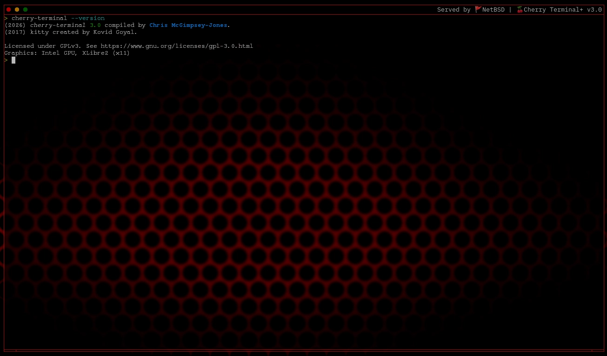

# 🍒Cherry Terminal+

  

A refined, GPU-accelerated terminal console for GNU Operating System / H-Linux.

Cherry Terminal+ is a Linux-focused terminal based on kitty, combining kitty's powerful terminal architecture with enhancements, 
H-Linux integration and a dedicated XLibre2/X11 build configuration.

Designed to provide a polished, responsive and feature-rich terminal experience, Cherry Terminal+ maintains close alignment with 
its upstream project while establishing its own identity within the H-Linux ecosystem.

## Features

### Terminal capabilities

- **GPU-accelerated rendering** — hardware-accelerated terminal rendering inherited from kitty's graphics architecture.
- **Integrated Matrix screensaver** — includes `screen`, a modern fork of cmatrix, compiled during the Cherry Terminal+ build.
- **Unicode support** — support for Unicode characters, emoji and font ligatures.
- **Image support** — terminal graphics capabilities through kitty's graphics protocol.
- **Shell integration** — enhanced interaction between the terminal and supported shells.
- **Kitten extensions** — a collection of kitty-inherited specialized utilities extending terminal functionality.

### Cherry Terminal+ enhancements

- Dedicated identity — Cherry Terminal+ branding, application identification and version presentation.
- Simplified version schema — Cherry-specific versioning and release identification.
- GNU Operating System / H-Linux integration — integration with H-Linux and software ecosystem.
- Installer integration — compatibility with the H-Linux installation framework.
- Targeted architecture — dedicated X11 build targeting.
- XLibre2 support — built for the XLibre2 X11 environment.
- Compatibility improvements — patches addressing existing kitty references and Cherry-specific integration.
- Updated Go dependencies — compatibility added for the regexp2 v2 API.
- Customiszble configuration — extensive control over appearance, behaviour, keyboard shortcuts and terminal settings.

## Platform and compile requirements

Cherry Terminal+ is developed for `GNU Operating System / H-Linux`, with its Cherry-specific build configuration targeting X11 
through XLibre2.

Supported display environment: `XLibre2` (X11).

The XLibre2 X server package `xlibre2-xserver` is required for the Cherry build configuration.

Cherry Terminal+ retains much of kitty's upstream architecture and build system.

Refer to the upstream project documentation for additional build dependencies and technical details.

## Project purpose

Cherry Terminal+ exists to provide a polished, integrated terminal console experience within the H-Linux ecosystem.

Rather than creating an entirely separate terminal architecture, it builds upon the established capabilities of kitty, 
preserving its upstream foundations while introducing targeted changes for the H-Linux environment.

The project aims to maintain compatibility, performance and functionality while providing a distinct terminal 
experience under the Cherry Terminal+ identity.

## Upstream Project

Cherry Terminal+ is based on `kitty`, created by **Kovid Goyal**.

We acknowledge and appreciate the work of the upstream developer and contributors.

Please support the original project:

https://www.github.com/kovidgoyal/kitty

## License

Cherry Terminal+ is licensed under the GNU General Public License v3.0 (GPLv3).

See https://www.gnu.org/licenses/gpl-3.0.html for details.

## Author

Chris McGimpsey-Jones (2026) <chrisjones.unixmen@gmail.com>

